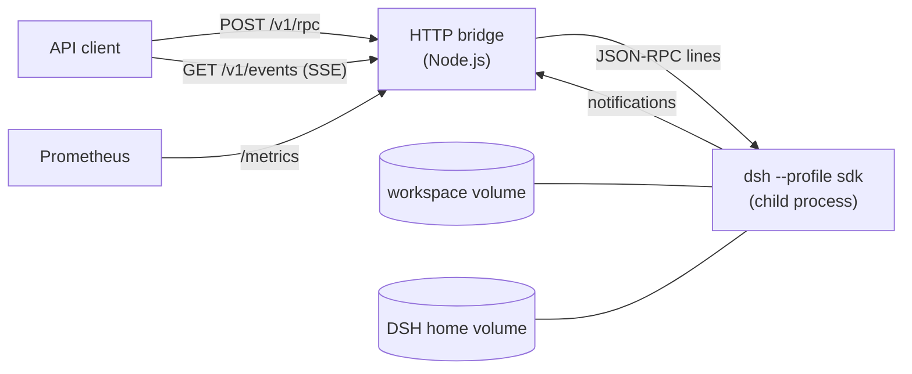

# DSH API Runtime

Runs [DeepSeek Harness](https://www.npmjs.com/package/@deepseek-ai/dsh) as an
**unauthenticated HTTP API** in a single container:

- `POST /v1/rpc` — one JSON-RPC request, notification, or response.
- `GET /v1/events` — Server-Sent Events stream of DSH notifications.
- `GET /v1/status`, `/healthz`, `/readyz`, `/metrics`.

DSH itself speaks newline-delimited JSON-RPC over stdio (`dsh --profile sdk`).
A small Node.js bridge owns the child process and exposes it over HTTP.

Everything is configured from `.env`; operations happen through `docker exec`
or plain `docker` commands. There is no Web UI and no authentication.

> [!WARNING]
> **Anyone with network access can execute agent tools in the workspace and
> consume model credits.** The default bind address is `127.0.0.1`. Exposing
> the API on any other interface requires `ALLOW_UNAUTHENTICATED_EXPOSURE=1`
> and a trusted network or an authenticating reverse proxy. See
> [Security](#security).

## Architecture



One bridge and one DSH child per container. Scale horizontally with more
containers; each container runs one provider/model route.

## Requirements

- Linux host with Docker Engine 24+ and Docker Buildx.
- Bash 4+.
- `git` (for the image revision label and the update flow).

No host Node.js or npm is required. All installs, builds, and tests run in
disposable containers.

## Quick start

```bash
# WORKSPACE_HOST must already exist and be writable by UID 1000.
sudo install -d -o 1000 -g 1000 /srv/dsh-workspace

cp .env.example .env
chmod 600 .env
$EDITOR .env                # set DEEPSEEK_API_KEY and WORKSPACE_HOST

scripts/build.sh            # multi-stage image build
scripts/run.sh -d           # detached, restart unless-stopped
scripts/smoke.sh            # fake-DSH smoke (no model credits)
```

Call the API:

```bash
curl -sS http://127.0.0.1:8080/v1/status | jq
curl -sS http://127.0.0.1:8080/v1/rpc \
  -H 'content-type: application/json' \
  -d '{"jsonrpc":"2.0","id":1,"method":"session/prompt",
       "params":{"sessionId":"demo",
                 "contentBlocks":[{"type":"text","text":"List the files in /workspace"}]}}'
curl -N http://127.0.0.1:8080/v1/events
```

Stop it with `scripts/stop.sh`. Volumes are never deleted by the scripts.

## Configuration

`.env` is a flat dotenv file:

- `KEY=VALUE`, one per line; blank lines and `#` comments are ignored.
- Values are literal — no shell expansion, no `eval`, no `source`.
- Surrounding single or double quotes are stripped.
- Duplicate keys, invalid keys (`^[A-Z][A-Z0-9_]*$`), and inline text after a
  closing quote are rejected.
- `.env` must not be group/world-readable unless `ALLOW_INSECURE_ENG=1`.

| Key | Default | Purpose |
|---|---|---|
| `IMAGE_REPOSITORY` | `dsh-api-runtime` | Local image repository name. |
| `IMAGE_TAG` | pinned DSH version | Image tag. Never published as `latest` automatically. |
| `NODE_IMAGE` / `NODE_IMAGE_DIGEST` | `node:24-trixie` | Builder image; digest is appended by `build.sh`. |
| `RUNTIME_IMAGE` / `RUNTIME_IMAGE_DIGEST` | `node:24-trixie-slim` | Runtime base image. |
| `CONTAINER_NAME` | `dsh-api` | Container name. |
| `BIND_ADDRESS` | `127.0.0.1` | Host interface for port publication. |
| `HTTP_PORT` | `8080` | Host port; the bridge always listens on container port 8080. |
| `ALLOW_UNAUTHENTICATED_EXPOSURE` | `0` | Required to publish on a non-loopback address. |
| `DSH_HOME_VOLUME` | `dsh-api-home` | Named volume for `DSH_HOME`. |
| `WORKSPACE_HOST` | `/srv/dsh-workspace` | Host directory mounted as the workspace. |
| `WORKSPACE` / `DSH_CWD` | `/workspace` | Workspace path inside the container. |
| `DSH_PROVIDER` | `deepseek-official` | DSH provider route. |
| `DSH_MODEL` | `deepseek-v4-flash` | Model name. |
| `DSH_REASONING_EFFORT` | empty | Optional reasoning effort. |
| `DSH_MAX_TOKENS` | empty | Optional positive output-token cap. |
| `DEEPSEEK_API_KEY` | — | Model credential (required). |
| `INIT_TIMEOUT_MS` | `60000` | Initialization timeout. |
| `RPC_TIMEOUT_MS` | `300000` | Per-request timeout. |
| `MAX_INFLIGHT` | `16` | Concurrent client requests waiting on DSH. |
| `MAX_BODY_BYTES` | `8388608` | Maximum `/v1/rpc` body size. |
| `ENABLE_APPROVALS` | `0` | Forward DSH approval requests to SSE clients. |
| `ENABLE_USER_QUESTIONS` | `0` | Forward `user-question/ask` to SSE clients. |
| `STOP_BUDGET_MS` | `25000` | Hard upper bound for bridge shutdown; must stay below the container stop timeout. |
| `MEMORY_LIMIT` / `CPU_LIMIT` | `2g` / `2` | Container resource limits. |
| `LOG_LEVEL` | `info` | `debug`, `info`, `warn`, `error`. |
| `DSH_TELEMETRY_MODE` | `DISABLED` | DSH's own product/session telemetry. |

`package.json` pins `@deepseek-ai/dsh` exactly; `.env` carries no separate DSH
version. `.env.example` deliberately leaves `IMAGE_TAG` empty so the tag
follows the pin and cannot drift after an update. The provider/model
identifiers above are the ones exercised by the SDK protocol in 0.2.2-rc.3;
`DSH_PROVIDER` must name a route DSH can resolve (`deepseek-official` mounts
the built-in DeepSeek adapter).

`run.sh` does **not** pass `.env` to Docker. It writes a private temporary
env file containing only the model credential, `DSH_*`, `LOG_*`, the bridge
limits, `WORKSPACE`, and `DSH_CWD`, and deletes it on exit.

## HTTP API

| Method | Path | Purpose |
|---|---|---|
| `POST` | `/v1/rpc` | Forward one JSON-RPC request, notification, or response. |
| `GET` | `/v1/events` | SSE stream of DSH notifications (event name `rpc`). |
| `GET` | `/v1/status` | Non-secret runtime status. |
| `GET` | `/healthz` | Process liveness. |
| `GET` | `/readyz` | `200` only after a successful DSH `initialize`. |
| `GET` | `/metrics` | Prometheus metrics. |

### `POST /v1/rpc`

Body: one JSON object, `Content-Type: application/json`, at most
`MAX_BODY_BYTES`. Batch arrays are rejected.

1. **Request** (`jsonrpc`, `id`, `method`, optional `params`) — forwarded to
   DSH; the matching response is returned with HTTP `200` (including JSON-RPC
   errors). IDs in flight are keyed by type and string value, so `1` and `"1"`
   are distinct. Duplicate in-flight IDs return `409`.
2. **Notification** (`jsonrpc`, `method`, no `id`) — forwarded; HTTP `202`.
3. **Response** (`jsonrpc`, `id`, exactly one of `result`/`error`) — forwarded
   to DSH when server-to-client requests (`ENABLE_APPROVALS`,
   `ENABLE_USER_QUESTIONS`) are enabled; HTTP `202`.

| Condition | HTTP | JSON-RPC error |
|---|---:|---|
| Malformed JSON | 400 | `-32700` |
| Invalid JSON-RPC shape | 400 | `-32600` |
| Body too large | 413 | `-32600` |
| DSH not ready | 503 | `-32000` |
| Too many in-flight requests | 429 | `-32002` |
| RPC timeout | 504 | `-32001` |
| Bridge internal failure | 500 | `-32603` |

`session/prompt` returns only an enqueue receipt:

```json
{"jsonrpc":"2.0","id":1,"result":{"messageId":"..."}}
```

It does not return the model's answer. Consume `/v1/events` or call
`session/wait`.

> **Timeouts do not cancel work.** DSH has no cancel method. A `504` means the
> bridge stopped waiting, not that the run stopped. Wait for
> `session.status` `{"status":"idle"}` or use `session/wait`; do not blindly
> retry a prompt after a timeout.

### `GET /v1/events`

```text
id: 42
event: rpc
data: {"jsonrpc":"2.0","method":"session.event","params":{...}}
```

- Every notification is forwarded verbatim.
- Browser `EventSource` clients must use `addEventListener("rpc", ...)`.
- Keepalive comment every 15 s; `Cache-Control: no-cache`,
  `X-Accel-Buffering: no`.
- Optional `?sessionId=` filter is best-effort; `subagent.*` notifications may
  mention several sessions.
- Slow clients are disconnected instead of buffering without bound.
- When a server-to-client request is forwarded, answer it with a JSON-RPC
  response on `POST /v1/rpc`. With no SSE client connected, the bridge
  cancels the request immediately.

### `GET /v1/status`

```json
{
  "ready": true,
  "dshVersion": "0.2.2-rc.3",
  "serverInfo": { "name": "deepseek-harness-sdk-runtime", "version": "0.0.1" },
  "pid": 123,
  "uptimeMs": 45678,
  "inflight": 1,
  "sseClients": 2,
  "lastExit": null,
  "config": { "provider": "deepseek-official", "model": "deepseek-v4-flash", "cwd": "/workspace" }
}
```

`serverInfo.version` is the wire-protocol identity, not the npm package
version; `dshVersion` is the package version.

### Prometheus metrics

`dsh_bridge_http_requests_total`, `dsh_bridge_http_request_duration_seconds`,
`dsh_bridge_rpc_requests_total`, `dsh_bridge_rpc_request_duration_seconds`,
`dsh_bridge_rpc_inflight`, `dsh_bridge_sse_clients`,
`dsh_bridge_events_total`, `dsh_bridge_dsh_up`,
`dsh_bridge_dsh_restarts_total`, `dsh_bridge_process_resident_memory_bytes`.

Labels are bounded (`method`, `route`, `status`). The `method` label uses a
fixed allowlist of protocol methods; unknown client-supplied names are counted
as `other`, so an unauthenticated client cannot inflate the number of series.
Session IDs and request IDs are never used as labels.

## Operations

```bash
docker logs -f dsh-api                       # JSON logs, DSH stderr prefixed [dsh]
docker exec dsh-api node -e "fetch('http://127.0.0.1:8080/v1/status').then(r=>r.text()).then(console.log)"
docker exec dsh-api /app/node_modules/.bin/dsh --version
scripts/stop.sh                              # volumes are preserved
```

`/healthz` proves the bridge is alive; `/readyz` proves DSH initialised. The
image healthcheck uses `/readyz`.

Supervision: if DSH exits, pending requests fail with `-32000`, readiness drops,
and the bridge restarts the child with exponential backoff (1 s → 30 s,
capped). More than 10 restarts in 5 minutes exits the bridge nonzero so Docker
restarts the container.

## Versioning, upgrades, rollback

The DSH version is pinned exactly in `package.json`; `IMAGE_TAG` defaults to it.

```bash
scripts/update-dsh.sh next          # or: latest, alpha, 0.2.2-rc.3
```

The updater resolves the channel in a disposable container, refuses a no-op,
updates `package.json`, `.env`, and `package-lock.json`, then runs
`build.sh` and the fake-DSH smoke test. It never commits; it prints the diff
and the rollback tag.

Before an upgrade, back up the DSH home volume — session storage can change
between prereleases:

```bash
docker run --rm -v dsh-api-home:/data:ro -v "$PWD":/backup alpine \
  tar czf /backup/dsh-api-home-$(date +%Y%m%d-%H%M).tgz -C /data .
```

Rollback: keep the previous image tag, then run it with the previous `.env`
(`IMAGE_TAG=<previous>`); the home volume backup is the safety net if schema
changes bite.

## Security

This service has **no authentication** by design.

- Default `BIND_ADDRESS=127.0.0.1`; `scripts/lib.sh` refuses a non-loopback
  bind unless `ALLOW_UNAUTHENTICATED_EXPOSURE=1`. The image itself listens on
  `0.0.0.0` inside the container (required for Docker port publishing), so
  this guard lives in `scripts/run.sh`; a direct
  `docker run -p 8080:8080 <image>` bypasses it.
- Remote access requires an authenticating reverse proxy, mTLS, or a private
  network. `/metrics` is unauthenticated too — expose it only to trusted
  scrapers.
- The container runs as UID 1000, with a read-only root filesystem, all
  capabilities dropped, `no-new-privileges`, a pids limit, and no Docker
  socket. Do not add `--privileged` or host networking.
- `.env` holds the model credential: mode `0600`, git-ignored, never baked
  into the image. `docker inspect` exposes container environment variables to
  anyone with Docker access.
- Logs never contain credentials, authorization headers, prompt content, or
  tool output.
- Base images can be pinned by digest; `package-lock.json` is authoritative
  and builds use `npm ci` with an explicit lifecycle-script allowlist. Sign
  and scan images before publishing.
- DSH's own product telemetry is disabled by default
  (`DSH_TELEMETRY_MODE=DISABLED`); enabling it is an explicit operator
  decision.

## Development and testing

All installs, builds, and tests run in disposable containers. Do not create a
host `node_modules`. `package-lock.json` (~10,800 lines) is the npm lockfile
and is committed intentionally so the image builds with `npm ci`;
`node_modules/` is git-ignored and must never be committed.

```bash
# Unit + fake-DSH integration tests, in a throwaway Node container
docker run --rm -v "$PWD":/src:ro -w /tmp/work node:24-trixie sh -c '
  mkdir -p /tmp/work && cp -a /src/. /tmp/work/ && cd /tmp/work &&
  npm ci --ignore-scripts --no-audit --no-fund &&
  node --test test/bridge.test.mjs'

# .env parser and validation tests
bash test/lib.test.sh

# Build, verify, smoke
scripts/build.sh
scripts/verify.sh
scripts/smoke.sh

# Paid live smoke
RUN_LIVE_SMOKE=1 scripts/smoke.sh
```

The fake DSH fixture (`test/fake-dsh.mjs`) implements `initialize`,
`session/prompt`, `session/wait`, `session/resume`, `shutdown`, and emits
`session.event` / `session.status` notifications deterministically.

The image sets `NARB_DISABLE_NATIVE_CACHE=1`. DSH's native addon loader
otherwise copies `.node` files into `os.tmpdir()` and `dlopen()`s them, which
fails because `/tmp` is mounted `noexec`. Loading the shipped prebuilds in
place avoids that and keeps `/tmp` hardened.

### Repository layout

```text
bridge/       HTTP listener, DSH supervision, metrics, config
scripts/      build, run, stop, smoke, verify, update-dsh, lib.sh
test/         fake DSH fixture and Node test suite
docs/         design proposal and implementation contract
```

## Troubleshooting

| Symptom | Check |
|---|---|
| `/readyz` stays 503 | `docker logs dsh-api`; the initial `initialize` failed (bad provider/model/key, unwritable `DSH_HOME`). |
| `503 -32000` on prompts | DSH child is restarting; watch `dsh_bridge_dsh_restarts_total`. |
| `504 -32001` | The bridge stopped waiting; the run may still be active. Watch `/v1/events` for `session.status: idle`. |
| Container exits at start | `.env` validation failed; the message names the key. |
| `WORKSPACE_HOST` permission errors | `sudo chown -R 1000:1000 <WORKSPACE_HOST>`. |
| `EADDRINUSE` on run | Another container already publishes `HTTP_PORT`. |

## License

MIT.
