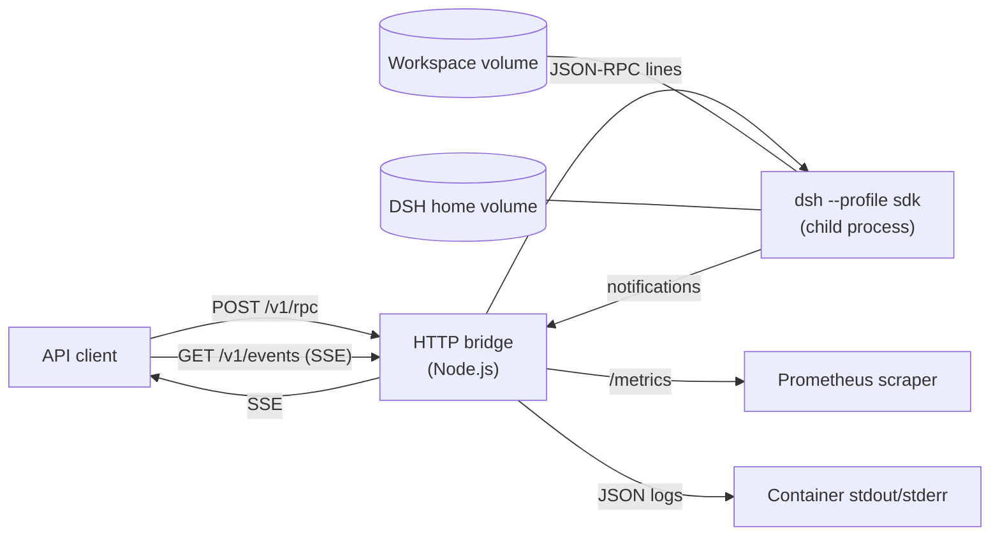

# DSH API Runtime — Specification

**Status:** implemented; tool configuration normalisation is tracked separately.
**Target:** the standalone repository `ggeorgovassilis/dsh-docker`.
**Goal:** a pure DSH container that exposes DeepSeek Harness as an unauthenticated HTTP API (JSON-RPC over HTTP plus SSE events), with Prometheus metrics. A derived tool-enabled image adds optional agent CLI tooling without changing DSH. Both variants are configured from `.env`, operated via `docker exec`, and upgraded with a one-command DSH update flow.

[Acceptance criteria](#acceptance-criteria) is the completion contract.

### Requirement map

| Requirement | Where it is specified |
|---|---|
| Everything runs in Docker (build and DSH run) | [Container image](#container-image), [Shell scripts](#shell-scripts) |
| Configuration through `.env`, operation via `docker exec` | [Configuration](#configuration), [Security](#security) |
| Shell scripts to build, run, stop, smoke-test, and upgrade | [Shell scripts](#shell-scripts) |
| DSH exposed over HTTP, no authentication | [HTTP API](#http-api), [Security](#security) |
| Telemetry exposed over HTTP (Prometheus) | [Telemetry](#telemetry) |
| Easy DSH updates via version/tag configuration | [Versioning and upgrades](#versioning-and-upgrades) |

---

## Scope and non-goals

### In scope

- Build two container images:
  - a pure image containing the official `@deepseek-ai/dsh` npm package pinned to an exact version, a small HTTP bridge, and Prometheus metrics over HTTP;
  - a tool-enabled image derived from the pure image, adding `git`, `gh`, `openssh-client`, Docker CLI/buildx, `ripgrep` and `procps`.
- Run either image with `docker run` or `docker compose`.
- Configure DSH from one `.env` file; expose tool settings only to the tool-enabled wrapper.
- Build, run, stop, smoke-test, and upgrade both variants with shell scripts.
- Expose DSH **without authentication**.

### Non-goals

- DSH Web UI, noVNC, Chromium, X11, Browser Use, plugin market, Super Agent.
- Third-party DSH plugins and plugin management.
- Multi-tenant authentication or authorization.
- Kubernetes manifests (the image must be Kubernetes-friendly, but manifests are out of scope).
- Reimplementing DSH or its SDK protocol.
- A web-based management interface. DSH ships one by default; we do not expose it. Configuration happens through `.env`, and anything `.env` does not cover is done with `docker exec`.

The security consequences of "no authentication" are documented once, in [Security](#security).

---

## Key decisions

| Decision | Choice | Rationale |
|---|---|---|
| DSH surface | `dsh --profile sdk` | The SDK is the API. It speaks newline-delimited JSON-RPC over stdio. |
| HTTP transport | `POST /v1/rpc` + `GET /v1/events` (SSE) | Simple, firewall-friendly, no WebSocket dependency. |
| Process model | one bridge + one DSH child per container | Simplest lifecycle and blast radius; scale with more containers. |
| Bridge | Node.js 24 ESM, Node's built-in `http` module | Same runtime as DSH; no second toolchain or extra framework dependency. |
| Initialization | bridge always auto-initializes | Clients can call `session/prompt` immediately; config comes from `.env`. |
| Config | flat `.env` dotenv file | Required by the project; keep it strict and shell-safe. |
| Management surface | `.env` + `docker exec`, no web UI | DSH's default web interface is a management surface we do not want to expose. |
| Telemetry | Prometheus `/metrics` on the API port | Pull metrics over HTTP; no OTLP push in v1. |
| DSH telemetry | disabled by default | Avoid sending product/session telemetry to DeepSeek. |
| Versioning | exact DSH version pinned in `package.json`; `.env` `IMAGE_TAG` defaults to it | Reproducible builds; one source of truth. |
| Image split | pure DSH image plus a derived tool-enabled image | DSH stays the baseline; agent CLI tools are an explicit extension. |
| Wrappers | `run-core.sh` / `run-tools.sh` over shared launch logic | The pure wrapper cannot accidentally inherit tool mounts or tool configuration. |
| Auth | none, by requirement | Default bind is `127.0.0.1`; wide bind requires an explicit opt-in flag. |

### Important correction about "HTTP API"

`dsh --profile sdk` is **stdio JSON-RPC**, not HTTP. The bridge is therefore mandatory, not optional. Do not expose the DSH Web server as the API; it is a different surface and drags in the Web/browser stack.

---

## Architecture



One HTTP listener on `HTTP_PORT` (default `3080`) serves `/v1/rpc`, `/v1/events`, `/v1/status`, `/healthz`, `/readyz`, and `/metrics`.

The launch boundary has two profiles:

| Profile | Wrapper | Image | Extra facilities |
|---|---|---|---|
| `core` | `scripts/run-core.sh` (and the `scripts/run.sh` alias) | `dsh-api-runtime:<version>` | None beyond DSH runtime dependencies. |
| `tools` | `scripts/run-tools.sh` | `dsh-api-runtime-tools:<version>` | Agent CLI tools and, when available, the host Docker socket. |

Both wrappers share `scripts/run-container.sh`; tool-specific mounts and environment are added only in the `tools` branch.

---

## Repository layout

```text
dsh-api-runtime/
├── .env.example
├── .gitignore
├── Dockerfile              # pure DSH runtime
├── Dockerfile.tools        # derived tool-enabled image
├── package.json
├── package-lock.json
├── README.md
├── bridge/
│   ├── server.mjs        # HTTP listener, routing, SSE, lifecycle
│   ├── dsh.mjs           # spawn, framing, JSON-RPC, init, supervision
│   ├── telemetry.mjs     # Prometheus metrics + JSON logging
│   ├── supervisor.mjs    # process supervision
│   └── config.mjs        # env parsing/validation
├── scripts/
│   ├── lib.sh            # shared helpers, image names, filtered runtime env
│   ├── build.sh          # builds pure image, then tools image
│   ├── run-container.sh  # shared launch logic for both profiles
│   ├── run-core.sh       # pure profile wrapper
│   ├── run-tools.sh      # tool-enabled profile wrapper
│   ├── run.sh            # backwards-compatible alias for run-core.sh
│   ├── stop.sh           # core | tools | all
│   ├── smoke.sh
│   ├── verify.sh
│   └── update-dsh.sh
├── test/
│   ├── fake-dsh.mjs      # deterministic JSON-RPC fixture for CI
│   ├── bridge.test.mjs
│   └── lib.test.sh
└── .github/workflows/
    ├── ci.yml
    └── update-dsh.yml
```

Host requirements: Linux (preferred), Bash 4+, Docker Engine 24+, Docker Buildx, and `git` (for revision labels). All Node/npm work happens in disposable containers.

---

## Configuration

### Contract

- `.env` is a flat, dotenv-style file: `KEY=VALUE`, one per line.
- Blank lines and lines starting with `#` are ignored.
- Values are **literal**. No shell expansion, no command substitution, no `eval`, no `source`.
- Surrounding single or double quotes are stripped.
- Duplicate keys are rejected.
- Keys must match `^[A-Z][A-Z0-9_]*$`.
- `.env` is git-ignored. `.env.example` is committed.
- `ENG_FILE=/path/to/file` overrides the default path (CI use).
- `scripts/lib.sh` refuses to proceed if `.env` is group/world-readable, unless `ALLOW_INSECURE_ENG=1` is set.

`package.json` is the single source of truth for the DSH version. `.env` does **not** carry a separate DSH version; `IMAGE_TAG` is the only tag knob and defaults to the pinned DSH version.

### `.env.example`

```dotenv
# Runtime
BIND_ADDRESS=0.0.0.0
HTTP_PORT=3080
WEB_PORT=8080
ALLOW_UNAUTHENTICATED_EXPOSURE=1

# Images and container names
IMAGE_REPOSITORY=dsh-api-runtime
TOOLS_IMAGE_REPOSITORY=dsh-api-runtime-tools
IMAGE_TAG=
CONTAINER_NAME=dsh
TOOLS_CONTAINER_NAME=dsh-tools

# Workspace
DSH_HOME_VOLUME=dsh-api-home
WORKSPACE_HOST=/srv/dsh-workspace
WORKSPACE=/workspace
DSH_CWD=/workspace
PROJECTS_PATH=

# Tool-enabled profile only
DOCKER_SOCKET=/var/run/docker.sock
# GH_TOKEN=github_pat_replace-me

# Provider/model
DSH_PROVIDER=deepseek-official
DSH_MODEL=deepseek-v4-flash
DSH_REASONING_EFFORT=
DSH_MAX_TOKENS=
DEEPSEEK_API_KEY=replace-me

# Limits and logging
MEMORY_LIMIT=12g
CPU_LIMIT=2
LOG_LEVEL=info
DSH_TELEMETRY_MODE=DISABLED
```

`.env` is shared by both wrappers for DSH settings, but only the tools wrapper
currently passes the legacy tool-specific values. The pure wrapper's filtered
runtime file excludes `GH_TOKEN`, `DOCKER_SOCKET`, `DOCKER_CONFIG` and
`GIT_CONFIG_GLOBAL`.


### Required validation

`scripts/lib.sh` must fail with a clear message when:

- `.env` is missing or unreadable;
- required keys are missing;
- `IMAGE_TAG` is not a valid Docker tag (no `+` build metadata, no `/`);
- `NODE_IMAGE` or `RUNTIME_IMAGE` already contains an inline digest (`*_DIGEST` are the digest inputs);
- `BIND_ADDRESS` is non-loopback and `ALLOW_UNAUTHENTICATED_EXPOSURE != 1`;
- no model credential is available;
- `DSH_PROVIDER`, `DSH_MODEL`, or `DSH_CWD` is empty.

### Runtime environment

The pure wrapper must not pass the whole `.env` file to Docker. `runtime_env_file` generates a temporary environment file containing only DSH/runtime values:

- `DEEPSEEK_API_KEY` and provider credentials matching `*_API_KEY`;
- provider endpoints matching `*_BASE_URL`;
- `DSH_*`;
- `LOG_LEVEL`;
- `INIT_TIMEOUT_MS`, `RPC_TIMEOUT_MS`, `MAX_INFLIGHT`, `MAX_BODY_BYTES`, `ENABLE_APPROVALS`, `ENABLE_USER_QUESTIONS`, `STOP_BUDGET_MS`;
- `WORKSPACE`;
- proxy variables (`HTTP_PROXY`, `HTTPS_PROXY`, `NO_PROXY`, `ALL_PROXY`).

The temporary file is deleted on exit. It must exclude tool-specific values such as `GH_TOKEN`, `GITHUB_TOKEN`, `DOCKER_SOCKET`, `DOCKER_CONFIG` and `GIT_CONFIG_GLOBAL`.

The tools wrapper currently retains the legacy behaviour of passing `.env` and adds the tool configuration paths it needs. Moving tool configuration and credentials to a dedicated tools volume is a follow-up; DSH itself must not gain tool-specific authentication code.

---

## Container image

### Pure image: `Dockerfile`

The pure image contains only DSH runtime dependencies:

- multi-stage `deps` build, with native packages rebuilt by explicit allowlist;
- `node_modules`, `package.json` and the bridge copied into the runtime stage;
- `ca-certificates` and `tini`;
- `pnpm`, retained because `dsh plugin` delegates profile package management to it;
- no `git`, `gh`, `openssh-client`, Docker CLI/buildx, `ripgrep` or `procps`;
- no `DOCKER_CONFIG` or `GIT_CONFIG_GLOBAL`.

The image label `io.example.dsh.variant` is `core`.

### Tool image: `Dockerfile.tools`

The tool image is derived, not a separate DSH build:

```dockerfile
ARG CORE_IMAGE
FROM ${CORE_IMAGE}
USER root
RUN apt-get update \
 && apt-get install --yes --no-install-recommends \
      docker-buildx docker-cli gh git openssh-client ripgrep procps \
 && rm -rf /var/lib/apt/lists/*
USER node
```

The image label `io.example.dsh.variant` is `tools`. The bridge, DSH version and entrypoint are inherited unchanged. Tool state is currently placed in the DSH home volume by the wrapper; it must not cause DSH code to acquire tool-specific behaviour.

### Build order

`scripts/build.sh`:

1. builds the pure image and tags it `${IMAGE_REPOSITORY}:${IMAGE_TAG}`;
2. builds `Dockerfile.tools` with `CORE_IMAGE` set to that exact image reference and tags it `${TOOLS_IMAGE_REPOSITORY}:${IMAGE_TAG}`;
3. verifies that both images run the pinned DSH version.

### Build reproducibility

- Pin `NODE_IMAGE`/`RUNTIME_IMAGE` by digest for release builds.
- Commit `package-lock.json`.
- Build with BuildKit; add `--sbom=true --provenance=mode=max` for release builds.
- Optionally sign with cosign and scan with Trivy/Grype in CI.
- Do not publish a floating `latest` tag. Tag by exact DSH version, e.g. `dsh-api-runtime:0.2.2-rc.5`.

### Runtime security

Both wrappers use these flags:

```text
--read-only
--tmpfs /tmp:rw,noexec,nosuid,nodev,size=256m
--cap-drop ALL
--security-opt no-new-privileges:true
--pids-limit 512
--user 1000:1000
--stop-timeout 30
```

The pure profile mounts only:

- `${DSH_HOME_VOLUME}:/home/node/.dsh`
- `${WORKSPACE_HOST}:${WORKSPACE}`
- `${PROJECTS_PATH}:${PROJECTS_PATH}` when configured

The tools profile additionally mounts `${DOCKER_SOCKET}:/var/run/docker.sock` when the socket exists, and adds the socket's group with `--group-add`. Mounting the Docker socket gives the container control of the host daemon, equivalent to root on the host. The pure image does not contain the Docker CLI and never receives the socket.

---

## DSH child process

### Spawn

```text
dsh --profile sdk
```

- Executable: `DSH_BIN`, default `/app/node_modules/.bin/dsh`. The smoke test overrides it with a fixture.
- `cwd`: `DSH_CWD` (normally `/workspace`).
- `HOME`: `/home/node`; `DSH_HOME`: `/home/node/.dsh`.
- Read `dsh --version` once at startup for `/v1/status`.
- `DSH_TELEMETRY_MODE`: `DISABLED` unless explicitly overridden.
- `NO_COLOR=1`, `TERM=dumb`.
- Pass model credentials through the environment.
- `stdio`: pipe stdin/stdout/stderr.

### Framing

- One JSON-RPC message per `\n`-terminated line.
- Read stdout with `readline`.
- Ignore malformed lines but log them at `warn` with a bounded preview.
- Write `JSON.stringify(message) + "\n"` to stdin.
- Honor stdin backpressure.
- Consume stderr continuously and forward it to the container's stderr with a `[dsh]` prefix. Never let a pipe fill and deadlock the child.

### Initialization

The bridge always auto-initializes on child start:

```json
{
  "jsonrpc": "2.0",
  "id": "bridge-init-<uuid>",
  "method": "initialize",
  "params": {
    "cwd": "/workspace",
    "provider": "deepseek-official",
    "model": "deepseek-v4-flash",
    "approvalRequests": false,
    "capabilities": { "userQuestions": false }
  }
}
```

- `reasoningEffort` and `maxTokens` are included only when set in `.env`.
- `approvalRequests` is `true` only when `ENABLE_APPROVALS=1`.
- `capabilities.userQuestions` is `true` only when `ENABLE_USER_QUESTIONS=1`.
- `/readyz` returns `200` only after a successful `initialize` response.
- If initialization fails, log the JSON-RPC error and exit nonzero. Do not serve a half-configured runtime.

The bridge's `initialize` is process-wide. Do not also accept a client `initialize`; DSH will reject the second handshake. For per-request model selection, use one container per model.

### Supervision

- `tini` is PID 1; the bridge is PID 2; DSH is a child of the bridge.
- On child exit:
  - reject all pending RPCs with a JSON-RPC error;
  - mark `/readyz` unavailable;
  - restart with exponential backoff: 1s, 2s, 4s, 8s, capped at 30s;
  - re-run initialization;
  - after 10 restarts in 5 minutes, exit nonzero so the orchestrator restarts the container.
- On `SIGTERM`/`SIGINT`:
  - stop accepting new HTTP requests;
  - send the DSH `shutdown` request;
  - wait up to 10s for exit;
  - `SIGTERM` the child, wait 5s, then `SIGKILL`;
  - close SSE clients and exit 0.

---

## HTTP API

### Endpoints

| Method | Path | Purpose |
|---|---|---|
| `POST` | `/v1/rpc` | Send one JSON-RPC request, notification, or response. |
| `GET` | `/v1/events` | SSE stream of DSH notifications. |
| `GET` | `/v1/status` | Non-secret runtime status. |
| `GET` | `/healthz` | Process liveness. |
| `GET` | `/readyz` | DSH child ready for traffic. |
| `GET` | `/metrics` | Prometheus metrics. |

No authentication. No CORS by default. Add `CORS_ORIGIN` only if a browser client requires it.

### `POST /v1/rpc`

Request body: one JSON object, `Content-Type: application/json`, max `MAX_BODY_BYTES`.

Accepted shapes:

1. **JSON-RPC request** — `jsonrpc`, `id`, `method`, optional `params`.
   - Forward to DSH.
   - Wait for the matching response, up to `RPC_TIMEOUT_MS`.
   - Return the DSH response object with HTTP `200`, even when it is a JSON-RPC error.
2. **JSON-RPC notification** — `jsonrpc`, `method`, no `id`.
   - Forward to DSH.
   - Return HTTP `202` with an empty body.
3. **JSON-RPC response** — `jsonrpc`, `id`, exactly one of `result` or `error`.
   - Forward to DSH, used only when server-to-client requests are enabled.
   - Return HTTP `202`.

Reject batch arrays with `400`.

Error mapping:

| Condition | HTTP | JSON-RPC error |
|---|---:|---|
| Malformed JSON | 400 | `-32700` Parse error |
| Invalid JSON-RPC shape | 400 | `-32600` Invalid Request |
| Body too large | 413 | `-32600` |
| DSH not ready | 503 | `-32000` DSH unavailable |
| Too many in-flight requests | 429 | `-32002` Busy |
| RPC timeout | 504 | `-32001` DSH timeout |
| Bridge internal failure | 500 | `-32603` Internal error |

Example:

```bash
curl -sS http://127.0.0.1:3080/v1/rpc \
  -H 'content-type: application/json' \
  -d '{
    "jsonrpc": "2.0",
    "id": 1,
    "method": "session/prompt",
    "params": {
      "sessionId": "demo",
      "contentBlocks": [{ "type": "text", "text": "List the files in /workspace" }]
    }
  }'
```

`session/prompt` returns only an enqueue receipt, for example:

```json
{"jsonrpc":"2.0","id":1,"result":{"messageId":"..."}}
```

It does **not** return the model's final answer. Clients must consume `/v1/events` and/or call `session/wait`.

> **Timeouts do not cancel work.** DSH has no cancel method. If an HTTP request times out, the underlying agent work may continue; a `504` means the bridge stopped waiting, not that the run stopped. Use `session/wait` with a generous timeout, or watch `/v1/events` for `session.status: idle`. Do not blindly retry a prompt after a timeout unless you can tolerate duplicate work.

Wait for the session to become idle:

```bash
curl -sS http://127.0.0.1:3080/v1/rpc \
  -H 'content-type: application/json' \
  -d '{"jsonrpc":"2.0","id":2,"method":"session/wait","params":{"sessionId":"demo"}}'
```

### `GET /v1/events`

Server-Sent Events stream:

```bash
curl -N http://127.0.0.1:3080/v1/events
```

```text
id: 42
event: rpc
data: {"jsonrpc":"2.0","method":"session.event","params":{"sessionId":"demo","event":{...}}}

```

- Every DSH notification is forwarded verbatim.
- The SSE event name is `rpc`. Browser `EventSource` clients must register `addEventListener("rpc", ...)`; `onmessage` only receives `message` events.
- `id:` is a monotonically increasing sequence number.
- Keepalive comment every 15s:
  ```text
  : ping
  ```
- Optional `?sessionId=` filter. Filtering is best-effort; `subagent.*` notifications may reference multiple sessions.
- Do not buffer unbounded history. If a slow client falls behind, close it rather than growing memory without bound.
- Set `Cache-Control: no-cache`, `Connection: keep-alive`, and `X-Accel-Buffering: no`.

Typical client sequence:

1. Open `GET /v1/events`.
2. `POST /v1/rpc` with `session/prompt`.
3. Read `session.event` notifications.
4. Wait for `session.status` with `"status":"idle"` or call `session/wait`.
5. Close the stream.

### `GET /v1/status`

Return non-secret state:

```json
{
  "ready": true,
  "dshVersion": "0.2.2-rc.3",
  "serverInfo": { "name": "deepseek-harness-sdk-runtime", "version": "0.0.1" },
  "pid": 123,
  "uptimeMs": 45678,
  "inflight": 1,
  "sseClients": 2,
  "lastExit": null,
  "config": { "provider": "deepseek-official", "model": "deepseek-v4-flash", "cwd": "/workspace" }
}
```

Never include credentials or prompt content.

### JSON-RPC ID handling

- The bridge keys pending requests by `typeof id + ":" + String(id)` to avoid `1` vs `"1"` collisions.
- Reject a client request whose ID is already in flight with HTTP `409` and error `-32600`.
- Preserve the original `id` value in the response.
- Do not reuse bridge-internal IDs for client requests. Bridge IDs use the prefix `bridge-`.

### Concurrency and limits

- At most `MAX_INFLIGHT` client requests waiting on DSH.
- Notifications do not count toward the limit.
- Enforce `MAX_BODY_BYTES`.
- Set socket timeouts to avoid slowloris.
- Do not buffer unbounded response bodies.

---

## Telemetry

### What "exposes telemetry via HTTP" means here

Prometheus pull metrics on the API port. No OTLP push in v1.

The bridge instruments its own HTTP/RPC boundary and process lifecycle. It can derive session-level counters/events from DSH notifications (`session.status`, `subagent.*`, `session.query.completed`). It does **not** scrape DSH internals. Token/cost metrics are available only if the notification payloads actually expose usage; do not promise them blindly.

### Metrics

Required metrics:

| Metric | Type | Labels |
|---|---|---|
| `dsh_bridge_http_requests_total` | counter | `method`, `route`, `status` |
| `dsh_bridge_http_request_duration_seconds` | histogram | `method`, `route` |
| `dsh_bridge_rpc_requests_total` | counter | `method`, `status` |
| `dsh_bridge_rpc_request_duration_seconds` | histogram | `method` |
| `dsh_bridge_rpc_inflight` | gauge | — |
| `dsh_bridge_sse_clients` | gauge | — |
| `dsh_bridge_events_total` | counter | `method` |
| `dsh_bridge_dsh_up` | gauge | — |
| `dsh_bridge_dsh_restarts_total` | counter | — |
| `dsh_bridge_process_resident_memory_bytes` | gauge | — |

Do **not** use session IDs, request IDs, or raw URL paths as metric labels: they are unbounded and can leak tenant identifiers. Use templated routes such as `/v1/rpc`, `/v1/events`, and `/v1/status`.

### Logs

- JSON lines to stdout/stderr.
- Include `ts`, `level`, `msg`, `request_id`, `rpc_id`, `method`, `session_id`, `duration_ms`, `status`.
- Never log API keys, authorization headers, prompt content, or tool output.
- Forward DSH stderr with a `[dsh]` prefix.
- Log the container's memory limit at startup, and when a supervised process
  dies by `SIGKILL`, read `memory.events` from the cgroup. A cgroup OOM kill
  leaves no log of its own, so without this it looks like an unexplained crash.

### DSH's own telemetry

- Set `DSH_TELEMETRY_MODE=DISABLED` by default.
- DSH's native product/session telemetry is separate from this bridge and may send data to DeepSeek. Enabling it is an explicit operator decision; review upstream documentation first.
- Do not conflate DSH's `serverInfo.version` (`0.0.1`, the wire protocol identity) with the DSH package version.

---

## Shell scripts

The scripts are thin wrappers over Docker; behaviour is specified here rather than full code.

### `scripts/lib.sh`

- `load_env` — load and validate `.env`.
- `die`, `warn`.
- `dsh_version` — read the pinned DSH version from `package.json`.
- `image` — core image reference.
- `tools_image` — derived tools image reference.
- `runtime_env_file` — generate the filtered DSH-only environment file and return its path.
- Container-name defaults: `CONTAINER_NAME=dsh`, `TOOLS_CONTAINER_NAME=dsh-tools`.

### `scripts/build.sh`

- Load and validate `.env`.
- Read the pinned DSH version from `package.json` and pass it as the `DSH_VERSION` build arg.
- Build the pure image with BuildKit, passing `IMAGE_VERSION` and `IMAGE_REVISION`.
- Build the tools image with `CORE_IMAGE` set to the exact pure image reference.
- Tag `${IMAGE_REPOSITORY}:${IMAGE_TAG}` and `${TOOLS_IMAGE_REPOSITORY}:${IMAGE_TAG}`.
- Default `IMAGE_TAG` to the pinned DSH version when empty.
- Verify both images with `docker run --rm --entrypoint /app/node_modules/.bin/dsh <image> --version`.
- Do not tag `latest` automatically.

### `scripts/run-container.sh`

Shared launcher selected by the two public wrappers.

- Load and validate `.env`.
- Refuse a non-loopback `BIND_ADDRESS` unless `ALLOW_UNAUTHENTICATED_EXPOSURE=1`.
- Build the required image if it is missing.
- Create the DSH home volume if missing.
- Default: foreground plus `--rm`, so `Ctrl-C` stops and removes it.
- `-d`: detached with `--restart unless-stopped` and without `--rm`.
- Apply the security flags from [Runtime security](#runtime-security) and the memory/CPU limits.
- Map host `HTTP_PORT` to container port `3080` and host `WEB_PORT` to container port `8080`.
- Pure profile: pass the filtered runtime env file and only DSH/workspace mounts.
- Tools profile: additionally mount the Docker socket when present, add its group, and set `DOCKER_CONFIG` and `GIT_CONFIG_GLOBAL`.
- Print the API and web UI URLs, the selected profile, and the container name.

### `scripts/run-core.sh` and `scripts/run-tools.sh`

Thin wrappers that call `run-container.sh` with `core` or `tools`. `scripts/run.sh` remains an alias for the pure wrapper.

### `scripts/stop.sh`

- `scripts/stop.sh` or `scripts/stop.sh core` removes the pure container.
- `scripts/stop.sh tools` removes the tools container.
- `scripts/stop.sh all` removes both.
- Never delete volumes.

### `scripts/smoke.sh`

Two layers:

1. **Fake-DSH integration test (always runs in CI).**
   - Run once against the pure image and once against the tools image.
   - Mount the fixture read-only and point the bridge at it with `-v "$PWD/test:/test:ro" -e DSH_BIN=/test/fake-dsh.mjs`.
   - Assert `/readyz`, `session/prompt`, SSE notifications and `/metrics`.
2. **Live smoke (opt-in, costs model credits).**
   - Require `RUN_LIVE_SMOKE=1` and a configured key.
   - Send a prompt such as "Reply with the single word OK".
   - Wait for idle, then stop.

`DSH_BIN` must be configurable so tests never need a real model.

### `scripts/update-dsh.sh`

```bash
scripts/update-dsh.sh next
scripts/update-dsh.sh latest
scripts/update-dsh.sh 0.2.2-rc.5
```

Steps:

1. Resolve the requested channel to an exact version with `npm view "@deepseek-ai/dsh@${channel}" version` in a disposable Node container.
2. Refuse to continue if the version is unchanged.
3. Update `package.json`'s exact `@deepseek-ai/dsh` dependency and `.env` `IMAGE_TAG`.
4. Regenerate `package-lock.json` in a disposable Node container: `npm install --package-lock-only --ignore-scripts`.
5. Run `scripts/build.sh` and `scripts/smoke.sh` (both image variants).
6. Print the diff and the rollback tag. Do **not** auto-commit.
7. In CI, open a PR with the version, lockfile, and test result.

### `scripts/verify.sh`

Assert:

- `package.json`'s pinned DSH version equals both images' `dsh --version` and image labels.
- The pure image has variant label `core` and no `gh`, `git`, `docker`, `rg` or `ps`.
- The tools image has variant label `tools` and contains those tools.
- `pnpm` remains available in the pure image.
- The filtered pure runtime environment excludes tool variables such as `GH_TOKEN`, `DOCKER_SOCKET` and `GIT_CONFIG_GLOBAL`.
- Both wrappers use the read-only/capability-drop security flags.
- No `latest` tag is produced.

---

## Versioning and upgrades

- The DSH version is pinned exactly in `package.json`. `.env` `IMAGE_TAG` defaults to it and is the only tag knob.
- `scripts/update-dsh.sh` takes a channel (`next`, `latest`, `alpha`) or an exact version; default to `next` because DSH is a prerelease and `latest` can lag.
- Keep at least the previous image tag for rollback.
- Back up the `DSH_HOME` volume before an upgrade. DSH session storage can change between prereleases.
- After an upgrade:
  1. run the fake-DSH smoke test;
  2. run the live smoke test if credentials are available;
  3. verify `/v1/status` reports the new DSH version;
  4. check that the SDK protocol still exposes the methods you depend on.
- Add a scheduled CI job (daily or weekly) that runs `scripts/update-dsh.sh` in a branch and opens a PR when a new version exists.

---

## Security

### No authentication

This is a deliberate requirement and the largest risk:

- Anyone with network access can execute agent tools in the workspace.
- Anyone with network access can consume model credits.
- There is no per-user isolation inside one container.

Mitigations:

- Default `BIND_ADDRESS=127.0.0.1`.
- Refuse `0.0.0.0`/`::` unless `ALLOW_UNAUTHENTICATED_EXPOSURE=1`.
- Document that a reverse proxy with auth, mTLS, or a private network is mandatory for remote access.
- Apply CPU/memory/pids limits at the container runtime.
- Use a dedicated workspace volume, not a broad host mount.
- Consider gVisor/Kata/Firecracker if the workload is untrusted.
- The metrics endpoint is unauthenticated too. Expose `/metrics` only to trusted scrapers or a private monitoring network.

### Docker socket

Only `scripts/run-tools.sh` mounts the host Docker socket. This makes the
tools container's isolation conditional:

- The socket grants control of the host Docker daemon, which is equivalent to
  root on the host (a client can start a privileged container and mount any
  host path).
- Anyone who can send requests to DSH can therefore reach the host through
  Docker.
- Do not expose the API to untrusted networks while the socket is mounted.
- Use the pure profile when Docker access is not needed; it neither installs
  the Docker CLI nor mounts the socket.

### Secrets

- `.env` contains model credentials and, optionally for the tools profile,
  `GH_TOKEN`. Mode `0600`, git-ignored, never baked into the image.
- The pure wrapper passes only the filtered DSH runtime environment, so
  `GH_TOKEN` and tool-specific variables never enter the pure container.
- The tools wrapper currently passes the legacy tool environment. Moving tool
  credentials to a dedicated tools volume and removing `GH_TOKEN` from
  `.env` is a follow-up.
- `docker inspect` exposes environment variables to anyone with Docker access;
  restrict Docker access.
- Never log credentials or request headers.
- Rotate keys if `.env` is leaked.

### Supply chain

- Pin base images by digest.
- Commit `package-lock.json`; build with `npm ci`.
- Use an explicit lifecycle-script allowlist.
- Run `npm audit signatures` in CI. Registry signatures prove the tarball matches what npm signed; they do not prove publisher intent. Treat the DeepSeek npm publisher account as a trust anchor.
- Generate an SBOM and provenance; sign the image.
- Scan the image before publishing.
- Pin CI actions by SHA.
- Prefer vendoring the DSH tarball into your own artifact store if registry availability is a concern.

---

## Testing and CI

### Test layers

1. **Unit tests** — `.env` parser, JSON-RPC shape validation and error mapping, pending-ID collision handling, SSE framing.
2. **Integration tests with fake DSH** — deterministic; covers startup, auto-init, RPC, SSE, metrics, shutdown, and restart.
3. **Live smoke (optional)** — requires credentials; run manually or in a protected CI job.
4. **Container tests** — non-root UID, read-only root filesystem, `/readyz` behavior, `/metrics` presence, image label/version assertions.

### CI workflow

On pull request:

- `npm ci` / lockfile check.
- Unit + fake-DSH integration tests.
- `scripts/build.sh` builds the pure and tools images.
- `scripts/verify.sh` checks both image variants and the pure/tools binary split.
- `scripts/smoke.sh` runs the fake-DSH test against both variants.
- Trivy/Grype scans both images.
- Verify non-root/read-only flags in the shared run script.
- `actionlint`/shellcheck (recommended).

On tag/release:

- `docker buildx build --platform linux/amd64,linux/arm64` for both images.
- `--sbom=true --provenance=mode=max`.
- cosign sign both images.
- Push to the registry.
- Keep the previous tags.

### Scheduled update workflow

- Run daily/weekly.
- Resolve the latest configured channel.
- If changed, run `scripts/update-dsh.sh`, build, fake smoke.
- Open a PR. Do not auto-merge.

---

## Acceptance criteria

The two-image split is done when all of the following are true:

- [ ] `scripts/build.sh` builds the pure image and a tools image derived from its exact tag.
- [ ] Both images run the pinned DSH version and report it in their image labels.
- [ ] The pure image does not contain `gh`, `git`, Docker CLI/buildx, `ripgrep` or `procps`.
- [ ] The tools image contains those tools.
- [ ] `scripts/run-core.sh` exists and does not mount the tools volume or Docker socket, and does not pass tool-specific environment variables.
- [ ] `scripts/run-tools.sh` exists and is the only public wrapper that selects the tools image and adds tool mounts/configuration.
- [ ] Both wrappers support foreground, detached, stop and recreate flows.
- [ ] `scripts/run.sh` remains a backwards-compatible alias for the pure wrapper.
- [ ] The pure wrapper's filtered runtime environment excludes `GH_TOKEN`, `GITHUB_TOKEN`, `DOCKER_SOCKET`, `DOCKER_CONFIG` and `GIT_CONFIG_GLOBAL`.
- [ ] The tools wrapper continues to support the Docker socket when available.
- [ ] `scripts/verify.sh` checks the pure/tools binary split and the filtered environment.
- [ ] `scripts/smoke.sh` runs the fake-DSH test against both image variants.
- [ ] CI builds, verifies and scans both images.
- [ ] `docs/dsh-api-runtime-implementation.md` describes the two-image architecture, wrappers, build order, credential/tool boundary and test requirements.
- [ ] `README.md` describes image selection, both wrappers, tool availability, Docker access and security implications.

---

## Open questions

Resolved during implementation:

1. `dsh --profile sdk` is the SDK surface used. The wire protocol
   (`initialize`, `session/prompt`, `session/wait`, notifications) is exercised
   by the fake-DSH fixture in CI; a live `initialize` and `session/prompt`
   remain to be confirmed by the opt-in live smoke test.
2. Provider/model identifiers are `DSH_PROVIDER=deepseek-official` and
   `DSH_MODEL=deepseek-v4-flash`; the credential env var is
   `DEEPSEEK_API_KEY`.
3. The pure image is the default runtime; tooling is an explicit derived image.
4. `scripts/run-core.sh` / `scripts/run-tools.sh` are the public wrappers;
   `scripts/run.sh` remains an alias for the pure wrapper.

Still open:

5. Do clients need server-to-client approvals or user questions?
6. Is POST + SSE acceptable, or must browser clients use WebSocket?
7. Should the workspace be a host bind mount or a named volume?
8. Which network/CIDR may reach the unauthenticated API, and who owns the reverse proxy or network policy?
9. When should tool configuration and GitHub credentials move from the legacy
   DSH-home paths to a dedicated tools volume?
